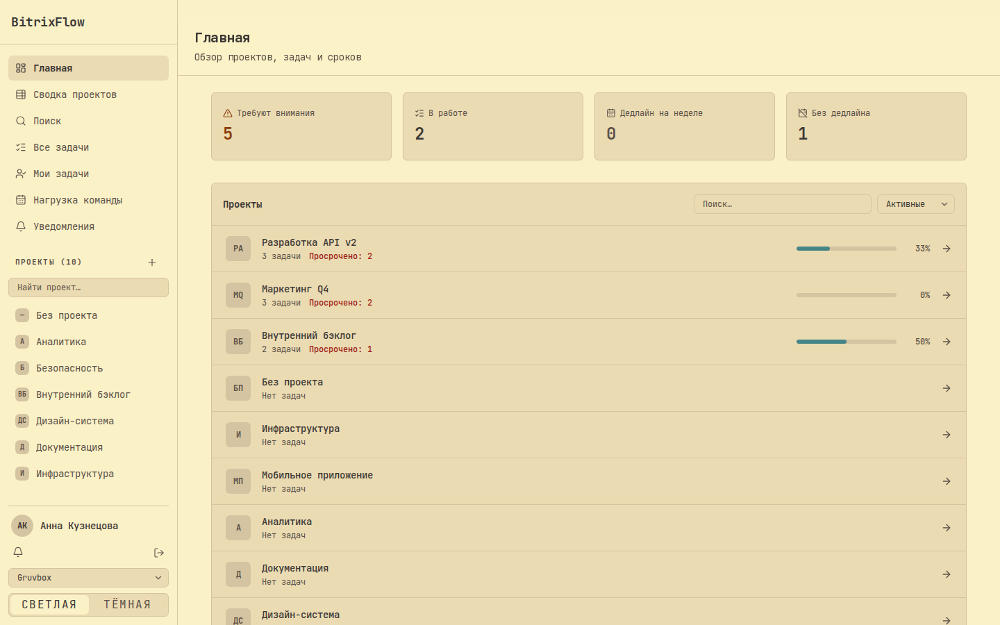
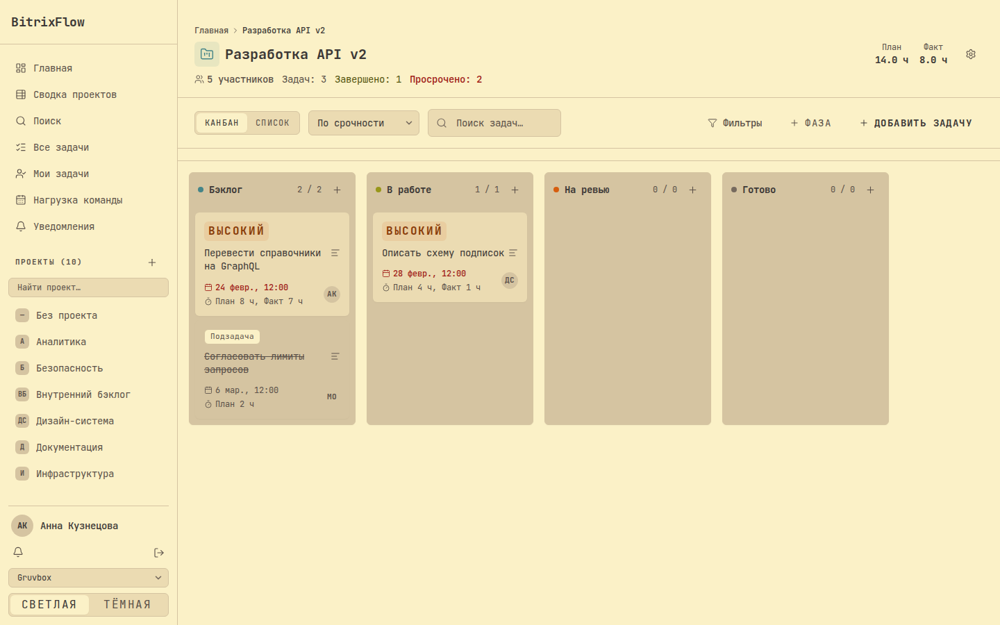
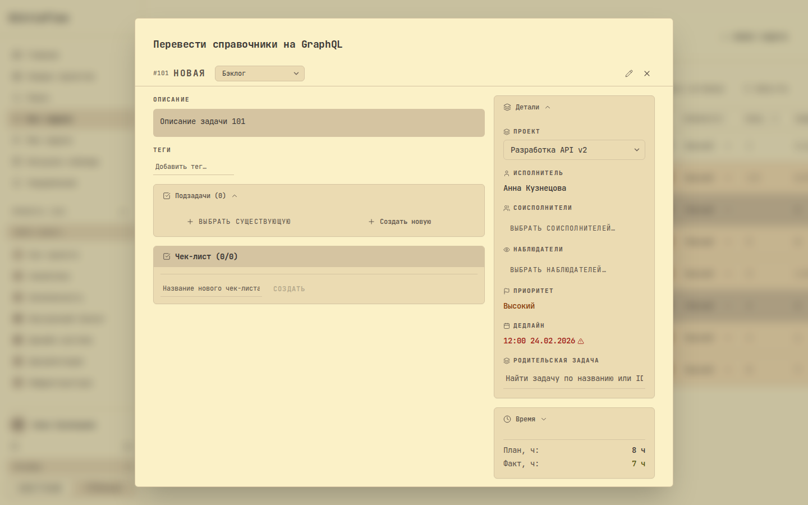
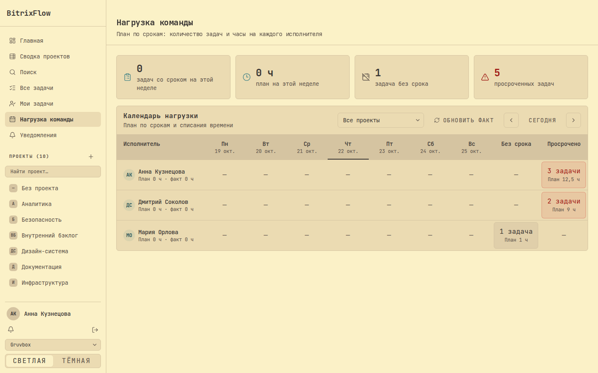
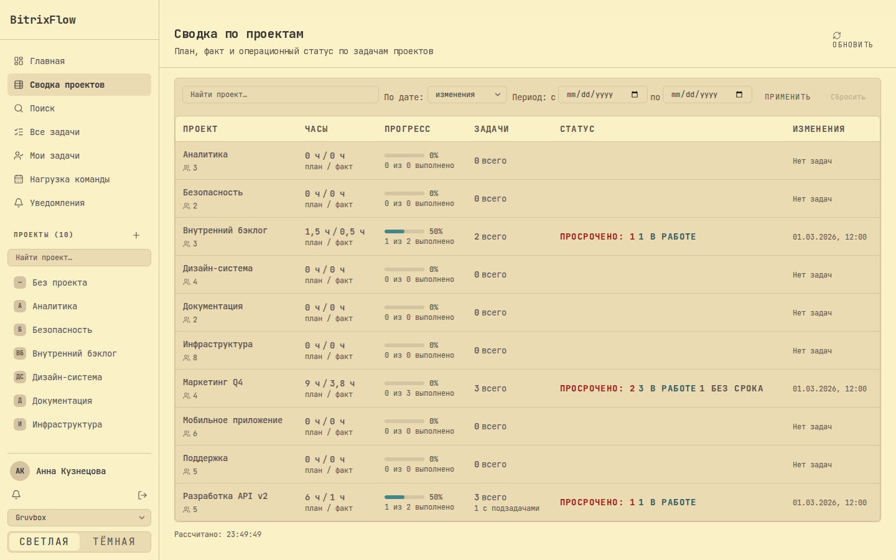
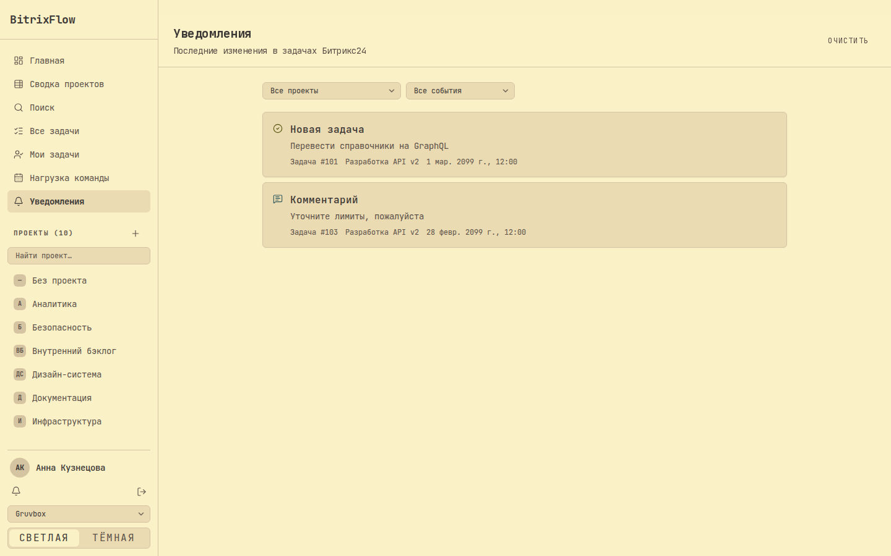
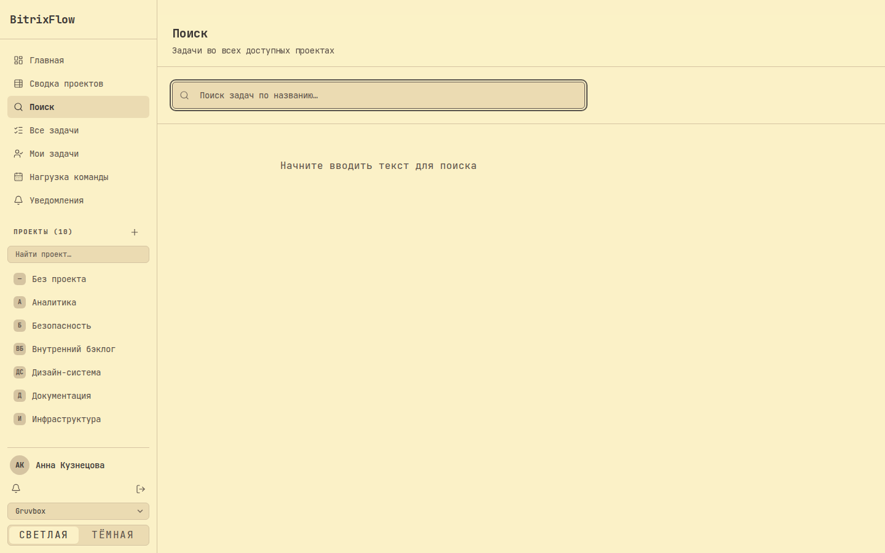

# BitrixFlow

Рабочее пространство для проектов и задач Bitrix24 в духе Asana. Приложение входит через
Bitrix24 OAuth, держит зеркало задач в MongoDB и принимает проверенные события задач для
фонового обновления.

Оформление: набор [@monos/ui](https://github.com/aa-blinov/monos-ui): палитры, токены и
примитивы берутся из пакета, а не пишутся здесь. Подробности в
[DESIGN.md](DESIGN.md).

Скрины ниже сняты на фиксированном наборе данных из UI-тестов (`MOCK_B24=1`, раздел
«UI-тесты» ниже), не на реальном портале: имена, проекты и задачи вымышленные.

Инструмент для внутренней команды EORA: руководители проектов и лиды смотрят сводку по
проектам, нагрузку команды и дедлайны; исполнители ведут свои задачи в «Моих задачах», на
канбане проекта и в карточке задачи.

[](LICENSE)

---

## Быстрый старт

```bash
cp .env.example .env.local
npm ci
npm run dev
```

Заполни все обязательные значения в `.env.local`. Файл специально в `.gitignore`: не вставляй
токены, пароли, строки подключения к Mongo и боевые URL в issues или коммиты.

В репозитории лежит `.npmrc` с `legacy-peer-deps=true`: набор объявляет Tailwind 3
как peer-зависимость, а приложение живёт на Tailwind 4. Токены и палитры набора от
Tailwind не зависят, поэтому расхождение безобидное — но `npm ci` без этого флага
падает на peer-конфликте.

Для продакшена укажи публичный **HTTPS**-адрес в `BITRIX24_APP_URL` и
`BITRIX24_REDIRECT_URI`. Bitrix24 должен достучаться до `/api/b24/handler`, чтобы доставлять
события.

Нужны Node.js 20 и MongoDB 7: те же версии, что в Dockerfile и CI.

## Что умеет

- **Вход через Bitrix24.** OAuth-приложение ставится на портал, токен портала хранится в
  MongoDB, а события задач приходят на `/api/b24/handler`.
- **Зеркало задач.** Списки и карточки читаются из MongoDB, а не из REST Битрикса на каждый
  запрос; портал остаётся источником правды.
- **Проекты и доски.** Канбан и список, стадии проекта, прогресс по стадиям, план и факт
  часов.
- **Карточка задачи.** Описание, теги, подзадачи, чек-лист, учёт времени и комментарии.
- **Гриды и фильтры.** «Мои задачи» и «Все задачи», фильтры по исполнителю, проекту,
  стадии, сроку, тегу и приоритету, группировки, сохранённые виды и настройки колонок.
- **Сводка и нагрузка.** План и факт часов по проектам, операционный статус, недельный
  календарь нагрузки по исполнителям с просрочками и задачами без дедлайна.
- **Уведомления и поиск.** Лента событий по задачам с фильтрами и поиск сразу по всем
  проектам.
- **Темы и клавиатура.** Шесть палитр в светлом и тёмном режиме, горячие клавиши `/`, `n`,
  `?` и переходы `g`, затем `h`, `t`, `m`, `w` или `s`, быстрое создание задачи.

## Экраны

**Главная**: счётчики просроченных задач и задач без дедлайна, проекты отсортированы:
самые просроченные наверху.



**Доска проекта**: канбан и список, прогресс по стадиям, план и факт часов.



**Карточка задачи**: описание, теги, подзадачи, чек-лист, учёт времени и комментарии.
Открывается поверх доски, а URL остаётся единственным источником правды для навигации
назад и вперёд.



**Нагрузка команды**: недельный календарь по исполнителям с отдельными блоками для
просроченных задач и задач без дедлайна.



**Сводка проектов**: план и факт часов, статус по каждому проекту, фильтр по периоду.



**Уведомления**: лента событий по задачам (новая задача, комментарий, смена статуса) с
фильтром по проекту и типу события, постраничная так же, как таблица задач.



**Поиск**: тот же поиск, что в таблице задач, только по всем проектам сразу.



## Конфигурация и переменные окружения

Значения берутся из `.env.local`. Шаблон лежит в [.env.example](.env.example), а сам
`.env.local` не коммитится.

| Переменная               | По умолчанию                             | Что задаёт                                                            |
| ------------------------ | ---------------------------------------- | --------------------------------------------------------------------- |
| `BITRIX24_CLIENT_ID`     | нет                                      | ID OAuth-приложения Bitrix24.                                         |
| `BITRIX24_CLIENT_SECRET` | нет                                      | Секрет OAuth-приложения.                                              |
| `BITRIX24_APP_URL`       | `http://localhost:3000` в `.env.example` | Публичный адрес приложения. От него строится URL обработчика событий. |
| `BITRIX24_REDIRECT_URI`  | `http://localhost:3000/api/oauth`        | Адрес callback. Должен совпадать с настройкой приложения в Bitrix24.  |
| `MONGO_URL`              | `mongodb://localhost:27017`              | Подключение к MongoDB.                                                |
| `MONGO_DB`               | `bitrix_kanban`                          | Имя базы.                                                             |
| `MONGO_USERNAME`         | нет                                      | Root-пользователь MongoDB для Docker Compose.                         |
| `MONGO_PASSWORD`         | нет                                      | Пароль root-пользователя.                                             |
| `MONGO_APP_USERNAME`     | `bitrix_app`                             | Пользователь приложения в MongoDB. Compose не стартует без него.      |
| `MONGO_APP_PASSWORD`     | нет                                      | Пароль пользователя приложения. Compose не стартует без него.         |
| `AUTH_USERNAME`          | `admin`                                  | Логин в приложение.                                                   |
| `AUTH_PASSWORD`          | нет                                      | Пароль в приложение.                                                  |
| `AUTH_SESSION_SECRET`    | нет                                      | Ключ HMAC для подписи сессионной куки.                                |
| `DUCKDNS_TOKEN`          | нет                                      | Токен DuckDNS для TLS-сертификата Caddy.                              |
| `SENTRY_DSN`             | пусто                                    | DSN Sentry. Без него отправка ошибок выключена.                       |
| `SENTRY_AUTH_TOKEN`      | пусто                                    | Токен загрузки source maps на сборке. На работу приложения не влияет. |
| `APP_RELEASE`            | `dev`                                    | Метка релиза в событиях Sentry.                                       |
| `MOCK_B24`               | `0`                                      | Мок Bitrix24 для UI-тестов и скриншотов. В продакшене не включать.    |
| `BACKUP_PASSPHRASE`      | пусто                                    | Пароль шифрования дампа MongoDB.                                      |
| `KEEP_DAYS`              | `14`                                     | Сколько дней хранить дампы.                                           |
| `HEALTH_URL`             | `BITRIX24_APP_URL/api/health`            | Адрес проверки в `scripts/health-watch.sh`.                           |
| `TEST_MONGO_URL`         | `mongodb://127.0.0.1:27018`              | База UI-тестов.                                                       |
| `SCREENSHOT_PORT`        | `3112`                                   | Порт сборки при съёмке скриншотов.                                    |

Compose дополнительно задаёт `HOSTNAME`, `PORT` и `MONGO_URL` для контейнера приложения.
Пароли и токены держи в секретах хостинга или GitHub, не в файлах репозитория.

## Как устроено

Приложение собрано на Next.js 16 (App Router, React 19), MongoDB 7 и Caddy в Docker
Compose. Короткая схема:

```text
Bitrix24 OAuth   -> user_tokens
Bitrix24 events  -> /api/b24/handler -> notifications, events_stream
                                    -> task_sync_jobs -> task_mirror
task_mirror      -> /api/tasks/all   -> React
events_stream    -> /api/events (SSE) -> React
```

1. **OAuth.** `/api/oauth/start` создаёт state и уводит на Bitrix24. `/api/oauth`
   принимает callback или прямую установку из маркетплейса, меняет код на токены и
   сохраняет их в `user_tokens`. После этого приложение подписывается на `OnTaskAdd`,
   `OnTaskUpdate`, `OnTaskDelete` и `OnTaskCommentAdd`.
2. **Сессия.** `/api/auth/login` сверяет `AUTH_USERNAME` и `AUTH_PASSWORD`, выдаёт
   подписанную HttpOnly-куку на 8 часов и пишет в MongoDB хэш сессии. `src/proxy.ts`
   закрывает всё, кроме входа, установки, OAuth, обработчика событий и `/api/health`.
3. **Зеркало.** Фоновый синк стартует из `src/instrumentation.ts` и раз в 60 секунд
   запрашивает задачи, изменённые с прошлого прохода, складывая их в `task_mirror`.
   Раз в 10 минут он сверяет состав задач и удаляет те, которых в Битриксе больше нет.
4. **События.** Обработчик проверяет `application_token`, пишет уведомление и запись в
   `events_stream`, помечает сводку устаревшей и ставит задачу на точечное обновление
   зеркала. Bitrix24 получает ответ до того, как эта задача выполнена.
5. **Чтение.** `/api/tasks/all` собирает список из `task_mirror` и `tasks` агрегацией
   MongoDB, с фильтрами, сортировкой и группировкой на сервере. `/api/events` отдаёт
   SSE-поток из `events_stream`.

Подробности и причины решений: [docs/architecture.md](docs/architecture.md).

### Оформление

Интерфейс собран на наборе [@monos/ui](https://github.com/aa-blinov/monos-ui): шесть
палитр в светлом и тёмном режиме, одна гарнитура (JetBrains Mono), один радиус, цвет
означает состояние, а не украшение.

| Что              | Как                                                                                         |
| ---------------- | ------------------------------------------------------------------------------------------- |
| Палитры и режимы | `data-theme` и `data-mode` на `<html>`, выбор в сайдбаре                                    |
| Токены           | `@monos/ui/styles.css`, подключён в `src/app/globals.css`                                   |
| Имена в Tailwind | мост `@theme inline`: пресет набора рассчитан на Tailwind 3, приложение живёт на Tailwind 4 |
| Примитивы        | `src/components/monos/*` — перенос набора в React                                           |

Выбор палитры хранится в `localStorage` (`bitrix-flow-theme`) и переживает перезагрузку.
Правила переноса примитивов и таблица замен классов — в
[docs/monos-ui-porting.md](docs/monos-ui-porting.md).

Приглушённые роли в части палитр набора не дотягивают до WCAG AA: в грувбоксе,
например, `ink-soft` на приподнятой поверхности даёт 3.65:1 вместо 4.5:1. Поэтому
значения таких ролей переопределены в `src/app/globals.css` — по каждой палитре и
режиму, сдвигом к чёрному в светлой теме и к белому в тёмной. Характер палитр
при этом сохраняется. Проверяет это `npm run check:contrast`.

## Разработка

Нужны Node.js 20, MongoDB 7 и npm. Для UI-тестов дополнительно нужен Docker: эталоны
сверяются в образе Playwright, а не в локальном Chrome.

### Команды

```bash
npm run lint            # ESLint и правила Next.js
npm run format:check    # проверка Prettier
npm run format          # применить Prettier
npm test                # юнит-тесты
npm run check:contrast  # контраст всех палитр набора (WCAG AA)
npm run build           # продакшен-сборка и проверка TypeScript
npm run check:utilities # классы набора действительно попали в CSS
npm run screenshots     # переснять картинки для README
```

GitHub Actions гоняет эти проверки на пул-реквестах и на пуше в `main`.

### UI-тесты

```bash
./scripts/ui-tests-docker.sh                     # прогон как в CI
./scripts/ui-tests-docker.sh --update-snapshots  # обновить эталоны
npm run test:ui                                  # быстрый прогон в системном Chrome
npm run screenshots                              # переснять картинки для README
```

Эталоны снимаются в образе `mcr.microsoft.com/playwright`, том же, что в CI: локальный
Chrome рисует шрифты чуть иначе, и попиксельное сравнение падало бы без единого изменения
в коде.

Тесты идут против сборки с `MOCK_B24=1` и отдельной базой `bitrix_kanban_test`: данные
фиксированные, поэтому скриншоты сравниваются попиксельно. Покрыты девять экранов в двух
вьюпортах (десктоп и телефон) плюс состояния: карточка задачи, фильтр с чипом, пустой
результат, диалог создания, тёмная тема, доска. Каждый экран заодно проверяется на ошибки
в консоли.

### Проверки интерфейса

Интерфейс проверяется axe-core (WCAG 2.1 A/AA плюс best practice) на всех девяти
экранах в светлой и тёмной теме: палитра меняет контраст, а тёмный режим — главный
источник «серых на сером». Порог: ноль нарушений. Элементам управления нужно доступное
имя, диалогам заголовок, а основной текст должен держать контраст 4.5:1.

Проверка живёт в `tests/ui.spec.ts` и гоняется тем же прогоном, что и скриншоты.

## Продакшен

```bash
docker compose --env-file .env.local up -d --build
```

У MongoDB нет проброса порта на хост, она доступна только внутри сети Compose. Держи
`.env.local` в режиме `0600` на хосте. Сессионная кука приложения `HttpOnly`; записи сессий
на сервере хранятся в MongoDB в виде хэша, поэтому выход из аккаунта отзывает сессию именно
этого устройства.

### Бэкапы

```bash
./scripts/backup-mongo.sh          # дамп в ./backups, хранит 14 дней
KEEP_DAYS=30 ./scripts/backup-mongo.sh
```

Запускай по cron на хосте. `backups/` в `.gitignore`. Задай `BACKUP_PASSPHRASE` в
`.env.local`: дамп несёт OAuth-токены портала и хэши сессий, поэтому архив шифруется
AES-256, если фраза задана. Восстановление:

```bash
openssl enc -d -aes-256-cbc -pbkdf2 -iter 200000 -pass env:BACKUP_PASSPHRASE \
  -in backups/bitrix_kanban_<stamp>.gz.enc | \
  docker compose exec -T mongodb mongorestore --archive --gzip --drop \
  --username "$MONGO_USERNAME" --password "$MONGO_PASSWORD" --authenticationDatabase admin
```

### Ошибки и алерты

Ошибки и трейсы уходят в Sentry через `@sentry/nextjs`: сервер и edge через
`src/sentry.*.config.ts` и хук `onRequestError`, браузер через `src/instrumentation-client.ts`
и оба error boundary. Задай `SENTRY_DSN` в `.env.local`; без него отправка выключена, и
локальные запуски с тестами остаются тихими.

DSN также зашит в клиентский бандл на этапе сборки (build-arg `NEXT_PUBLIC_SENTRY_DSN`,
прописан в `docker-compose.yml`). Сорс-мапы загружаются, только если на сборке задан
`SENTRY_AUTH_TOKEN`; без него сборка всё равно проходит, просто стектрейсы будут указывать
на минифицированный код. `APP_RELEASE` помечает события релизом, передавай коммит:

```bash
APP_RELEASE=$(git rev-parse --short HEAD) docker compose --env-file .env.local up -d --build
```

Внешняя проверка доступности для cron на хосте (лучше с другой машины):

```bash
*/2 * * * * cd /path/to/bitrix-kanban && ./scripts/health-watch.sh >> backups/health.log 2>&1
```

Она дёргает `/api/health` и при падении шлёт событие `HealthCheckFailed` в тот же проект,
дальше алерт идёт обычным маршрутом.

### Если сайт отдаёт 502

Сервисам заданы фиксированные адреса в подсети `172.32.10.0/24`: docker DNS иногда
переставал резолвить имена контейнеров, и прокси ходит по адресу, а не по имени. Если
приложение при этом живо (`docker compose exec app wget -qO- localhost:3000/api/health`
отвечает `ok`), а сайт всё равно недоступен:

```bash
docker compose --env-file .env.local down && docker compose --env-file .env.local up -d
```

`scripts/health-watch.sh` делает это сам (не чаще раза в 15 минут) и шлёт алерт, только если
после пересоздания сайт так и не ответил.

### Здоровье и мониторинг

`GET /api/health` отвечает без сессии и пингует MongoDB, поэтому `docker compose ps` пишет
`healthy`, только пока приложение реально достаёт до базы. Compose перезапускает сервис
после трёх подряд неудачных проверок.

### Защита прокси

Caddy добавляет HSTS, `nosniff`, `Referrer-Policy` и политику `frame-ancestors`, которая
разрешает встраивание только в собственный origin приложения и порталы Bitrix24. Список
правится в `caddy/Caddyfile`, если приложению нужно работать внутри другого хоста.

## Перед публикацией на GitHub

1. Прогони `git status --ignored` и проверь, что `.env.local`, `.next` и `node_modules`
   игнорируются.
2. Прогони команды из раздела **Команды**.
3. Добавляй remote и делай push только после `git diff --cached`.
4. Значения для деплоя держи в секретах GitHub или хостинга, никогда в переменных
   репозитория или файлах воркфлоу.

## Лицензия

[MIT](LICENSE), © Alexander Blinov, 2025-2026. Условия целиком в файле [LICENSE](LICENSE).
